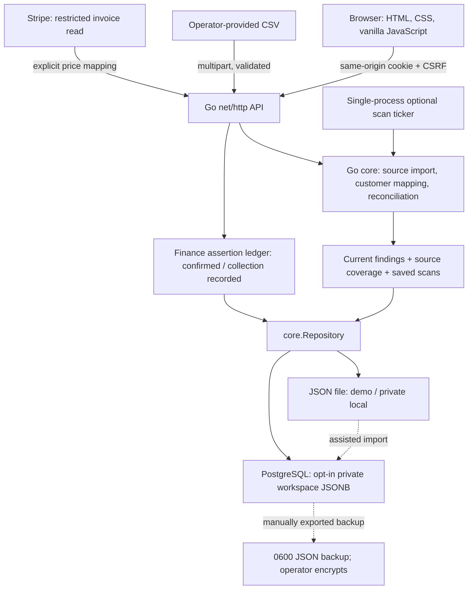
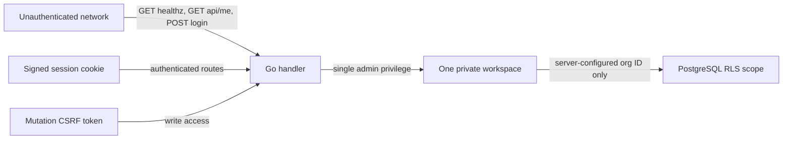
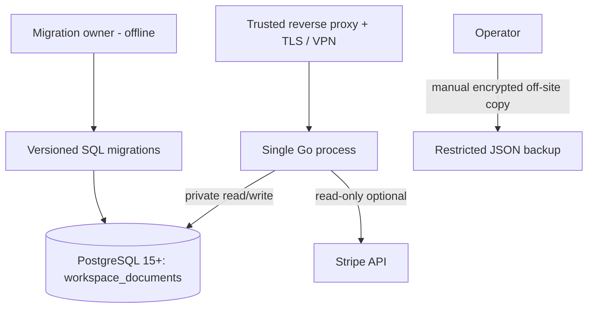
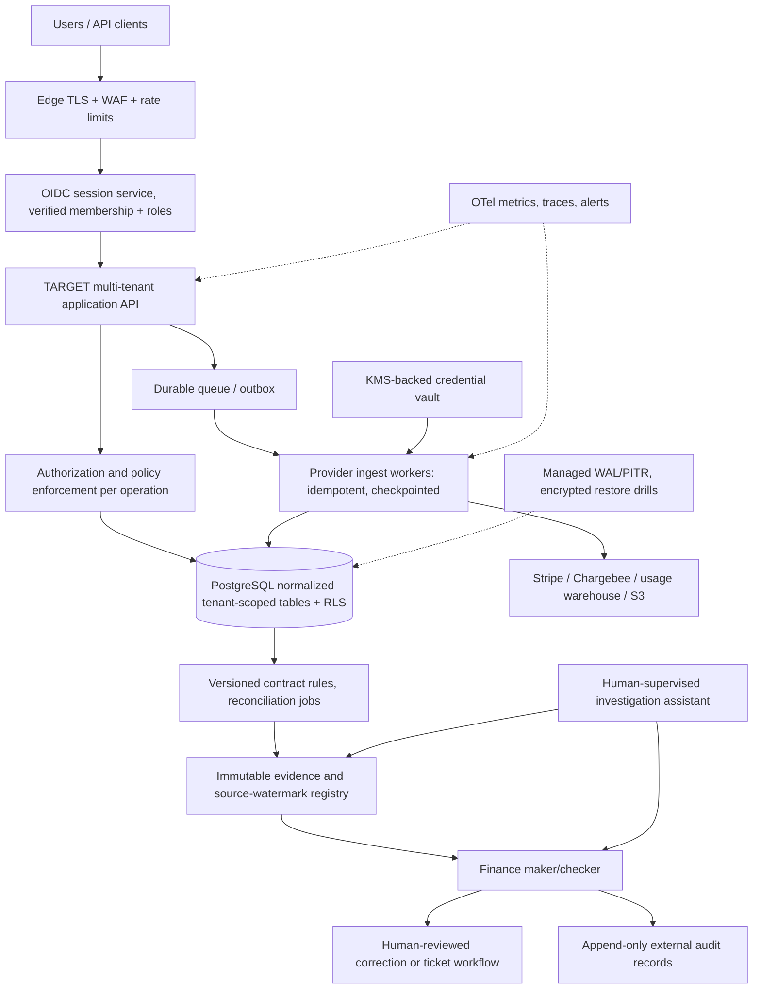

# Architecture reference — current system and target SaaS

**Status:** This document separates **the implemented v0.2 pilot** from a **proposed production architecture**. Diagram boxes labeled TARGET are not runnable services.

## 1. Implemented runtime — logical components



- `cmd/server/main.go`: environment validation, startup, demo seed, storage choice, schedule and graceful shutdown.
- `internal/server`: HTTP router, signed cookie, CSRF checks, login limiter, import/export and review handlers.
- `internal/core`: data models, validations, rules engine, source coverage, evidence history, recovery assertions.
- `internal/stripe`: optional restricted invoice read; no write operations to Stripe.
- `internal/pgstore`: PostgreSQL JSONB `core.Repository`, transaction-local `app.organization_id`, non-owner runtime role checks, serializable writes.
- `cmd/migrate-pilot` and `cmd/backup-workspace`: guarded single-org operations.
- `web`: dashboard, investigations, evidence viewer, uploads and operator recovery form.
- `db/migrations`: versioned SQL foundation, org-aware schema and RLS.
- `.github/workflows/ci.yml`: gofmt, vet, race, browser smoke, Docker and PostgreSQL integration/tenant isolation.

The running Go app is **not** a shared multi-tenant app. `WORKSPACE_ID` selects one static private organization for the entire server, and `ADMIN_PASSWORD` is a single admin secret.

## 2. HTTP request and data flow

```mermaid
sequenceDiagram
  actor Operator
  participant UI as Browser
  participant HTTP as Go API
  participant Repo as Repository
  participant Engine as Reconciliation
  Operator->>UI: Import validated source CSV
  UI->>HTTP: POST /api/import/kind (session, CSRF)
  HTTP->>HTTP: Bound size; parse all rows before changes
  HTTP->>Repo: Update(private snapshot)
  Repo->>Engine: Upsert source and reconcile closed periods
  Engine-->>Repo: Findings, coverage gaps, saved run + SHA input digest
  Repo-->>HTTP: Atomic commit (or rollback)
  HTTP-->>UI: Row count and import result
  Operator->>UI: Review finding evidence
  UI->>HTTP: GET /api/findings, /api/scans
  HTTP->>Repo: Read()
  Repo-->>HTTP: Current data and history
  HTTP-->>UI: Evidence and statuses
  Operator->>UI: Approve investigation
  UI->>HTTP: POST /api/findings/id/status
  Operator->>UI: Record separate confirmation or collection assertion
  UI->>HTTP: POST /api/findings/id/recovery
  HTTP->>Repo: Atomic, idempotent, evidence-version guarded append
  Repo-->>UI: Assertion only, NO money transfer
```

### Reconciliation boundary

Sources are imported and reconciled **inside one repository Update**. An error rejects the entire mutation. The PostgreSQL adapter uses serializable transactions, selecting the organization-scoped JSONB row with `FOR UPDATE`. In JSON mode, updates are process-mutex protected and written via a temporary file + sync + rename. The JSON file mode is single-process only.

A saved run snapshots source inputs, calculations, findings, coverage and version/fingerprint. The latest **25** runs are retained. It does not snapshot later review or recovery events into the original run; those are live operator records. The last **500** activity events are not cryptographically immutable.

### Login, authorization and trust boundaries



Current protections: signed HttpOnly SameSite=Strict cookie, HMAC CSRF on writes, same-origin CSP, upload validation/limits, no-store API responses, login throttling in process, restricted optional Stripe key, and non-owner PostgreSQL role checks. **Missing:** authenticated identities and memberships, end-to-end RBAC, MFA/SSO, reverse-proxy-aware secure cookie hardening, KMS secret encryption, request-level cross-tenant negative tests, independent security testing.

`GET /healthz` proves only that the web process responds; it does **not** prove database connectivity, source ingestion freshness, readiness or provider availability.

## 3. Deployment — what exists

**A. Local demo:** Go 1.23+, `DEMO_MODE=true go run ./cmd/server`; localhost-only unauthenticated synthetic data, ignored JSON storage.

**B. Private JSON workspace:** `ADMIN_PASSWORD`, independent `SESSION_SECRET`, `DATA_FILE`; bind to localhost or trusted TLS reverse proxy, firewall and VPN. The JSON repository does not work safely with multiple application processes.

**C. Experimental private PostgreSQL workspace:** provision organization using migrations, grant a non-owner runtime role SELECT org + SELECT/INSERT/UPDATE workspace document. Set `DATABASE_URL`, `WORKSPACE_ID`, `ADMIN_PASSWORD`, strong `SESSION_SECRET`, and disable demo. Stores one organization's entire pilot state in one JSONB row. A different server can be configured for a different org, but this is **not** a substitute for centralized authentication or a multi-tenant service.



Use `docs/POSTGRESQL-FOUNDATION.md` for explicit provisioning, migration, backup and limitations. No CI job currently certifies public cloud production deployment or a hardened IaC environment.

## 4. TARGET production service — not implemented



### Recommended runtime interfaces

`Principal{user_id, organization_id, memberships, roles}` must come from verified OIDC claims and membership DB lookup—not a browser-provided tenant ID. All tenant data queries require an explicit trusted principal and a transaction-scoped, parameterized organization context. Separate API route checks from SQL RLS as defense in depth. Use short-lived access/session tokens with server-side revocation, clear session expiration/rotation and per-role authorization tests.

Split repositories into `ContractsRepository`, `UsageRepository`, `InvoicesRepository`, `CreditsRepository`, `CasesRepository`, `EvidenceRepository`, `ApprovalsRepository`, `JobsRepository`. Avoid a global JSON document for production throughput. Preserve every source-native ID, provider, retrieval timestamps, line-level provenance, currency, rounding policy and rule version. Use database transactions + outbox events for guaranteed-once business effects atop at-least-once delivery.

### Idempotency and recovery design

- Provider ingest key: `(organization_id, connector, source_record_id, version)`, with immutable ingest-batch provenance and cursor.
- Job key: `(organization_id, connector, requested_scope, source_cursor)`; retries bounded, exponential backoff with jitter, DLQ for terminal/manual review.
- Rule run key: `(organization_id, rule_version, source_fingerprint, period)`; avoid duplicate parallel scans and stale results.
- Finance approval: two **distinct authenticated actors**, review policy and evidence fingerprint; no user can approve their own mutation if a policy requires separation of duties.
- Money reporting: potential, finance-confirmed, **provider/bank-verified** cash collection as distinct aggregates; never aggregate currencies.
- Audit: append-only, attributed to authenticated principal, externally protected or cryptographically chained with retention.
- Disaster recovery: encrypted WAL backups, PITR, regular isolated restore, bounded RPO/RTO, runbooks and incident communication.

## 5. Architecture decision records

| ADR | Decision | Reason / tradeoff |
| --- | --- | --- |
| 001 | Go backend | Small deployable binary, explicit typed financial logic |
| 002 | Deterministic integer currency math | Avoid untraceable AI arithmetic; requires tested rules and overflow boundaries |
| 003 | Source evidence separate from findings | Reproducibility and explainable cases |
| 004 | Provider-independent CSV first | Fast controlled pilots; more manual operations |
| 005 | Optional read-only Stripe | No payment write credentials or platform lock-in |
| 006 | Bounded single JSON workspace | Cheap self-hosted demo; not scale/multi-process safe |
| 007 | Transitional PostgreSQL JSONB single org | Durable private persistence without risky simultaneous relational rewrite; serial row write bottleneck |
| 008 | Transaction-local RLS as defense in depth | Blocks accidental cross-org SQL reads; custom setting does not authenticate requests |
| 009 | Guarded import + restricted backup | Preserve pilot evidence, never overwrite target; no PITR/encryption provided |
| 010 | Operator-only recovery ledger | Prevent conflation of calculated discrepancies with cash; bank verification/maker-checker remain future work |

## 6. Traceability

Code: `cmd/server`, `internal/server`, `internal/core`, `internal/pgstore`, `internal/stripe`, `web`, `db/`, `cmd/migrate-pilot`, `cmd/backup-workspace`.  
Supporting specs: `docs/DATABASE-DESIGN.md`, `docs/INTEGRATIONS.md`, `docs/API.md`, `docs/WORKFLOWS.md`, `docs/SECURITY-OPERATIONS.md`, `docs/TEST-STRATEGY.md`, `docs/IMPLEMENTATION-PLAN.md`.  
**Acceptance:** A design document is not evidence of running implementation; the exact production gates are in `docs/IMPLEMENTATION-PLAN.md`.
