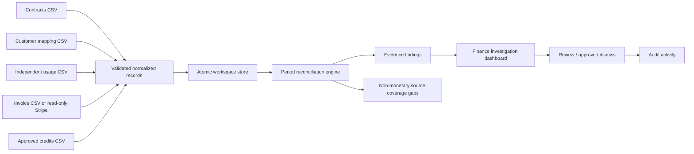

# Architecture and technical decisions

## Scope

RevenueLeak OS v0.2 is a **single-workspace, local or private-hosted SaaS revenue reconciliation pilot**. The business problem is underbilling and lost billable usage. The engineering priority is repeatable math, source traceability and explicit human review rather than an autonomous AI collection agent.

## Data flow

The browser provides the dashboard and upload/review forms, communicating only with same-origin JSON APIs. The Go backend handles authentication, parsing, persistence, Stripe API requests, evidence creation and workflow changes.

### Implementation layers

- `cmd/server`: startup, configuration, listener, first-run synthetic demo data.
- `internal/server`: HTTP API, session, CSRF, export, import, activity logging.
- `internal/core`: data contracts, validation, idempotent upserts, persistent state, reconciliation engine.
- `internal/stripe`: optional read-only Stripe invoice client with mapping and bounded pagination.
- `web`: responsive browser interface without external runtime dependencies.
- `samples`: checked-in CSV templates.

### Reconciliation invariant

- All comparisons are made within a **customer + month + metric + currency** grouping; currencies are **never summed** across currencies.
- A period is eligible only after its last day plus 7 full days (UTC). Current months are never flagged.
- The applicable contract version is the latest effective start month covering the period. Contract validity is monthly, not daily.
- The expected charge is `max(0, usage-included) * unit_rate`, floored by the minimum commitment and reduced by explicit credits.
- A monetary finding is generated **only if expected exceeds finalized billed amount**. Separate **coverage warnings** are emitted for active minimum-commitment months with no independent usage or finalized invoice; these warnings cannot establish a collectible amount and do not affect monetary portfolio totals. Draft and void invoices are disregarded. Negative and foreign-currency invoice lines are skipped at import, and currency mismatches cause the comparison to be skipped.
- Finding IDs are deterministic by customer/month/metric. Statuses survive only when that case's evidence fingerprint is unchanged. Changed evidence reopens reviewed cases; notes and first-seen timestamps remain.
- Evidence includes stable source record IDs and numerical inputs used for the comparison. A finding status change cannot modify financial source data.
- Corrections and monetary recoveries happen entirely outside this application. Review does not mean invoicing or collecting.

### Data persistence

In the **default local JSON mode**, each user action is modeled as a copy-on-write transaction under a process-local mutex. Data is saved as JSON to a `0600` temporary file, synced and atomically renamed into place before becoming the active in-memory snapshot. This supports process restarts, single-instance pilots and prevents partial file content under normal operating conditions. The filesystem must support atomic renames and persistent writable storage.

This approach is **not** multi-process-safe, does not implement a transaction log, cannot support simultaneous pods or efficiently query large histories, and does not replace PostgreSQL for a multi-tenant production service.

An **optional PostgreSQL private-workspace adapter** now implements the same `core.Repository` interface. It persists the pilot state as one JSONB workspace document, guarded by a validated static organization UUID, a nonprivileged runtime DB role, forced row-level security, transaction-local organization context, serializable write transactions and retries for serialization conflicts. The Go server can select this backend using `DATABASE_URL` and `WORKSPACE_ID`. This is a transitional private-workspace persistence mode: normalized relational source tables and per-user/multi-tenant authorization are not wired to API handlers yet. See [PostgreSQL foundation](POSTGRESQL-FOUNDATION.md).

### Auth and trust boundaries

A single admin authenticates using a server-side environment password. Successful login creates an expiring signed HttpOnly/SameSite=Strict cookie; state-changing requests require a per-session HMAC-derived CSRF token. `DEMO_MODE=true` with no password is accepted only when binding to `127.0.0.1` or localhost. No browser request contains the Stripe restricted key; the connector reads credentials from server environment variables. The application never uses generative AI for monetary computations.

### Evidence classification

The engine categorizes a positive variance as missing invoice, unbilled usage, minimum shortfall, or price mismatch. Labels are heuristics to prioritize financial investigation and are not proof of which system caused the discrepancy.

## Future production target

In phase 2, replace the single-file store with PostgreSQL tables for organizations, users, memberships, connector configurations, versioned contracts, source records, ingest jobs, reconciliation runs, findings, evidence references and append-only audits. Add a queue for idempotent source ingestion, signed provider webhooks, tenant-based database RLS or strict repository filters, OAuth/KMS-backed credential storage, rate limits, structured tracing and periodic snapshot reconciliation.

See `ROADMAP.md` for the concrete engineering and go-to-market sequence.

## Saved run transaction

Runtime paths use `core.RunScan` inside `Store.Update`. Source mutation, reconciliation, current finding changes, sequence increment and the saved run are committed atomically. An error leaves both the live data and run history unchanged. Each run owns copied source and finding slices. Import edits and later review edits cannot mutate a saved snapshot. The store upgrades older JSON files with an empty history; it does not invent historical evidence.

Runs contain all input contracts, usage, billing and credits, the result summary and findings, a rule version, trigger, source digest and sequence-based ID. The latest 25 runs are kept newest first. Run IDs are unique during that workspace's lifetime, but a destructive demo reset begins a new workspace history. Case fingerprints normalize record order by stable IDs so a row reorder does not invalidate review. An evidence fingerprint is an ordinary hash, not a digital signature.

`GET /api/scans` returns summaries only. Detail and export endpoints require the same authenticated session as other private APIs and send `Cache-Control: no-store`. Source snapshots exclude environment credentials and sessions but retain customer/financial data. See RECONCILIATION-RUNS.md for retention and API.md for contracts.

## Source coverage assurance (pilot)

`internal/core/coverage.go` enumerates the 12 most recent eligible closed months after the configured grace period, bounded by each contract's effective interval. It selects the effective contract version per customer/metric/month and checks whether at least one independent usage record **or** finalized paid/open billing line exists. Months lacking both are stored as `CoverageGap` warnings, exposed at `GET /api/coverage`, and copied into saved scan history. Their contextual contract minimum is never added to the revenue discrepancy total.

The warning means **data missing from this workspace**, not necessarily billing omitted at the source. Unrecorded cancellation, incomplete provider synchronization, invoice adjustments, or commercial exceptions may explain it. A single usage or invoice line satisfies the narrow both-absent test; separate future rules should check full-source completeness, ingestion freshness, and invoices still in progress. No payment or correction action is authorized by these warnings.

## Provider ID resolution

Canonical customer IDs come from contract records. Optional explicit `CustomerMapping` rows are keyed by provider/source plus exact external customer identifier. The reconciliation engine applies mappings on a per-source basis (Stripe or CSV billing, independent usage CSV, credits CSV) without rewriting stored raw provider IDs. Source coverage checks use the same mappings to avoid false missing-evidence warnings. Every saved reconciliation run includes the active mapping source data and source digest; previous snapshots remain immutable after a later mapping import. Unknown billing sources and synthetic demo invoices are not treated as CSV by default.

**Trust boundary:** Mappings are finance-controlled input assumptions, not identity proof. They should eventually have maker-checker approval, collision detection, ingestion provenance, tenant isolation and provider ID validation before customer-production use. Data from unmatched sources is not silently merged by display name.

## Full architecture and product references

This original architecture note records the v0.2 pilot design. The expanded [architecture reference](ARCHITECTURE-REFERENCE.md) details current runtime diagrams, API/security trust boundaries, private PostgreSQL transactions, intended multi-tenant architecture, targeted agent orchestration and technical decision records. See [database ER diagrams](DATABASE-DESIGN.md), [workflows](WORKFLOWS.md), [complete product handbook](PRODUCT-HANDBOOK.md), [operations](SECURITY-OPERATIONS.md) and [implementation gates](IMPLEMENTATION-PLAN.md). Current pilot recovery records are separate operator-entered finance assertions and are **not** independent cash verification. The active app still uses a single-admin JSON or JSONB workspace rather than the normalized SQL tables.
