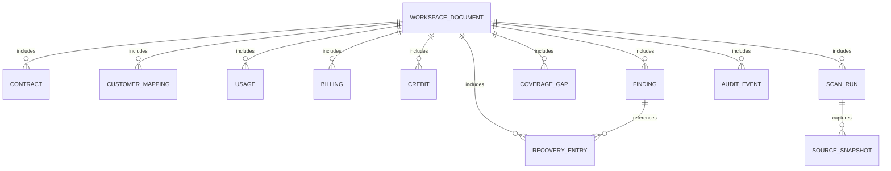
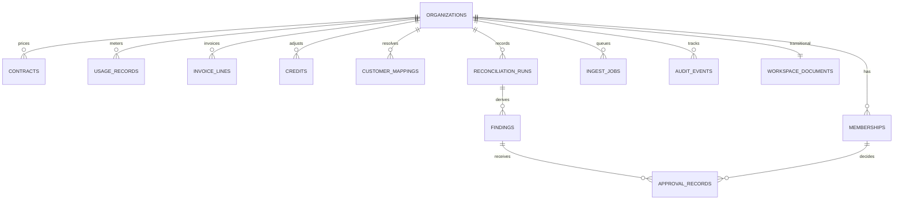
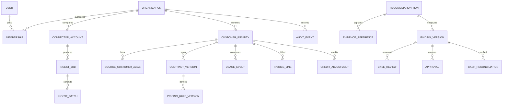

# Database design and source-of-truth model

**Current reality:** The live Go API stores one organization's pilot data in a `core.Database` JSON object. In PostgreSQL mode this object is in the RLS-protected `workspace_documents.state` JSONB column. **The normalized finance tables in migration 0001 are present but NOT used by the live application.** Never assume two sources of truth exist or are synchronized.

## A. Implemented pilot model



All the child 'relationships' above are **conceptual array references** inside one document, not SQL foreign-key constraints in the running adapter.

| Object | Key fields | Operational behavior |
| --- | --- | --- |
| `Contract` | customer_id, customer_name, metric, currency, unit_price_cents, included_units, monthly_minimum_cents, effective_from/effective_to | A per-customer, per-metric monthly rate version; newest applicable start date wins |
| `CustomerMapping` | source, external_customer_id, customer_id | Exact provider-scoped alias; source-native IDs remain on raw rows |
| `Usage` | usage_id, customer_id, period, metric, quantity | Independent metering, keyed by imported usage ID |
| `Billing` | line_id, invoice_id, customer_id, period, metric, quantity, amount_cents, currency, status, source | Invoice lines; paid/open included in current reconciliation, draft/void excluded |
| `Credit` | credit_id, customer_id, period, metric, amount_cents, reason | Explicit approved service credit, never inferred from a model |
| `Finding` | id, customer_id, period, metric, kind, currency, potential_cents, expected_cents, billed_cents, credited_cents, source evidence IDs, evidence_digest, status, note | Deterministic current finding; only active positive variance cases are maintained |
| `CoverageGap` | id, customer_id, period, metric, currency, monthly_minimum_cents, reason, explanation | Non-monetary warning; must not enter financial totals |
| `ScanRun` | id, trigger, rule_version, grace_days, summary, source_digest, sources, findings, coverage | Input/output snapshots, last 25 retained; previous runs not altered by new imports |
| `RecoveryEntry` | id, finding_id, customer_id, currency, evidence_digest, action, amount_cents, note, at | Operator confirmation/collection assertion; appends on successful write; not bank-attested |
| `AuditEvent` | id, at, action, detail | Last 500 events; no actor identity beyond single workspace |
| `Database` | all arrays, scan_sequence, last_scan, updated_at | Full atomic workspace snapshot; no multi-user query isolation |

All currency values are integer **minor units** (such as cents). Supported pilot currencies are USD, EUR, GBP. Period strings are `YYYY-MM`. Source evidence uses external line/event IDs; a finding ID derives from customer/period/metric. Avoid floats in financial computations and avoid ambiguous quantity units.

### Critical invariants

- A metric's rate belongs to exactly one contract/customer/period interpretation; manually verify signed terms and credit semantics.
- Re-importing a source record with the same stable key **updates** that record. This does not establish end-to-end deduplication across two providers.
- Cross-currency invoice matching is rejected/skipped; financial totals cannot mix currencies.
- A draft/void invoice is not finalized billing; neither is an absent record proof of money owed.
- Source coverage checks are **separate** from expected-billed gaps.
- Each saved scan captures source and result state at that instant. Its fingerprint is ordinary SHA-256, **not** an authenticated signature.
- Review status survives unchanged evidence and reopens when evidence fingerprint changes.
- Recovery events reference the source evidence version and case. Current confirmation excludes stale evidence. Historical reported collections are not silently erased.
- Recoveries and audit events are appended in application code; **the underlying JSON/JSONB storage is mutable** and is not a tamper-proof accounting ledger.
- Backups export the entire snapshot, including sensitive financial identifiers and internal notes. They are not encrypted by the application.

## B. Implemented PostgreSQL schema

`db/migrations/0001_tenant_foundation.sql` creates `revenueleak.organizations`, `memberships`, `contracts`, `customer_mappings`, `usage_records`, `invoice_lines`, `credits`, `reconciliation_runs`, `findings`, `approval_records`, `ingest_jobs` and `audit_events`.

`0002_workspace_documents.sql` adds the transitional runtime table:

```sql
CREATE TABLE revenueleak.workspace_documents (
  organization_id uuid PRIMARY KEY REFERENCES revenueleak.organizations(id),
  state jsonb NOT NULL DEFAULT '{}'::jsonb,
  version bigint NOT NULL DEFAULT 0 CHECK (version >= 0),
  updated_at timestamptz NOT NULL DEFAULT now()
);
-- The migration also enables and FORCEs RLS and adds an org-scoped policy.
```

The SQL above is a readable schematic; use the actual versioned migration files, not a pasted statement, to provision a database. Each per-org table uses forced row-level security (RLS). `current_organization()` reads `app.organization_id` transaction-locally, and finance foreign keys use `(organization_id, id)` where needed. Runtime database role must not own the tables or bypass RLS. **Custom session settings alone are not secure end-user authorization.**



### SQL tables and indexes

| Table | Primary / dedupe key | Important indexes and constraints |
| --- | --- | --- |
| organizations | id UUID; unique slug | org RLS policy uses `id` |
| memberships | (organization_id, id) | unique (org, issuer, subject), intended role enum |
| contracts | (organization_id, id) | unique (org, customer, metric, effective_from); nonnegative amounts; monthly dates |
| customer_mappings | (org, source, external_customer_id) | canonical customer ID; limited source enum |
| usage_records | (org, source, external_usage_id) | (org, period, external_customer_id), nonnegative usage |
| invoice_lines | (org, source, external_line_id) | (org, period, external_customer_id), amount/status/currency checks |
| credits | (org, source, external_credit_id) | nonnegative amount and month checks |
| reconciliation_runs | (org, id), unique (org, run_key) | (org, created_at DESC), digest, JSONB sources/summary |
| findings | (org, id) | org-qualified FK to scan run; (org, status, created_at DESC) |
| approval_records | (org, id) | composite FK to finding + membership |
| ingest_jobs | (org, id), unique (org, connector, idempotency_key) | (org, status, next_attempt_at), retries |
| audit_events | (org, id) | (org, recorded_at DESC), member link |
| workspace_documents | organization_id | RLS-protected versioned JSONB snapshot (live private mode) |
| schema_migrations | filename + checksum | migration-owner-only ledger; NOT part of public tenant API |

**Schema/live-model mismatch (must be resolved):** The normalized schema currently does not fully represent every pilot field, including the newest recovery ledger, all credit and evidence semantics, custom currencies, contract exceptions and durable history. Build explicit SQL migrations and a reviewed semantic field map **before** switching `core.Repository` to normalized queries. SQL schema existence is not feature completion.

## C. TARGET normalized SaaS model — planned



### Normalized design conventions

1. Every tenant-owned table has a mandatory `organization_id`; composite foreign keys prevent one org linking to another's child row.
2. All queries use a server-verified organization principal plus transaction-local org scope, and RLS enforces defense in depth. Test cross-org GET/POST/import/export paths, not only SQL.
3. Source records are immutable/versioned: dedupe by provider, source ID and revision. Corrections produce new event versions, not silent mutation of historical evidence.
4. Contract versions have effective dates, supersession and uploaded evidence references. Only **approved** rate versions feed monetary calculation.
5. Currency uses ISO code and integer minor units or a reviewed decimal type with currency exponent checks. No currency conversion without explicit FX source/date.
6. Invoice lines include invoice ID, line ID, finalized state, provider, credits/discount/tax treatment and event timestamp. Avoid double-counting CSV+provider copies.
7. Pricing engine stores ruleset version, coverage assumptions, skip codes and source fingerprints; any source correction creates a new run and invalidates affected approvals.
8. Cases have stable identities but versioned outcomes; status, assignee, comments, classifications and signed-off amount live separately from calculated evidence.
9. Confirmation, authorized correction and **independently verified** receipts have distinct records. Recovery receipts need bank/payment-provider linkage and reconciliation to avoid self-reported cash claims.
10. Audit log is append-only, user-attributed and independently protected. Keep subject access, data minimization, tenant-specific retention and deletion policies.
11. Use partition/index strategies based on observed billing volumes; benchmark ingestion and query plans before assuming a design scales.

## D. Data lifecycle and cutover

**Pilot import:** `cmd/migrate-pilot` reads a bounded offline JSON file, refuses unsafe sources, imports into an unused private PostgreSQL JSONB workspace, and verifies a canonical JSON digest. It does not migrate into normalized SQL tables.  
**Pilot backup:** `cmd/backup-workspace` exports an organization-scoped snapshot to a mode-0600 JSON file, never overwrites existing backups, and supports fresh-org restore tests. Encryption and off-site retention are the operator's responsibility.  
**Production target:** build online/offline versioned migration process: preflight integrity, independent backup, maintenance window, stable source checksum, deterministic normalization, shadow reads, row counts, per-customer financial comparisons, rollback/forward-fix strategy, traffic cutover and post-cutover verification.

### Release acceptance for relational cutover

- Every current pilot field round-trips without losing case status, history, financial raw IDs or source digest.
- Mixed fixture datasets with two organizations retain **zero** cross-tenant visibility and zero cross-org foreign-key association.
- Production runtime uses a least-privilege non-owner role; unauthorized or missing tenant returns no rows, not other organizations' data.
- Concurrent imports, scheduled scans, retry and backfill never double-count or corrupt evidence.
- Restores can be executed in an isolated environment with measured recovery time and verified contents.
- Reviewed source terms, price tiers and precision pass finance-authorized fixtures.

This is a specification and acceptance checklist—not a claim that the normalized runtime has already shipped.
