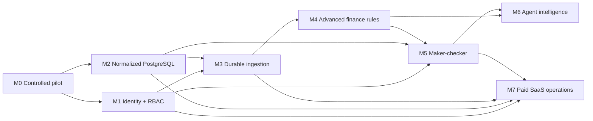

# Production development plan and GitHub-ready roadmap

**Current:** RevenueLeak OS v0.2 is a working evidence-first **single-admin pilot**. Opt-in PostgreSQL persistence is one private workspace per app process. This plan is **the implementation queue**, not a statement that planned functionality has shipped. Work should be delivered in focused pull requests with tests and release notes; no '100% bug free' claims.

## North-star outcomes

1. **Correctness:** independently sourced usage + contract + invoice evidence produces finance-accepted discrepancy cases with a measured false-positive rate.
2. **Trust:** no cross-tenant data exposure, least-privilege connectors, human review and independently verified recovery claims.
3. **Automation:** connect, ingest and reconcile data continuously with completeness watermarks and observable job retries.
4. **Workflow:** finance analysts investigate cases efficiently, with assigned owner, approval trace and correction closure.
5. **Commercial viability:** paid design partners provide measurable ROI and a willingness to pay recurring fees; do not assume $10k MRR until sales exist.

## Milestone M0 — Current controlled pilot (implemented)

Shipped: Go web app and API, single-admin login, CSV source parser, simple monthly rate cards, explicit mappings, deterministic reconciliation, 7-day grace, source coverage, current findings, 25 saved runs, notes/reviews, 500 activity events, optional read-only Stripe, opt-in static-source scheduled scans, private PostgreSQL JSONB adapter, forced-RLS schema foundation, offline migration and manual backup/fresh-org restore, and an operator assertion ledger for current-evidence confirmation versus reported collection.

**Remaining even at pilot level:** real finance fixture signoff, source completeness procedures, user-tested UI, end-to-end recovery validation using independent bank records, manual backup encryption runbook and design partner permissions/processing terms.

## Milestone M1 — User identities and tenant authorization (P0 release blocker)

**Scope:** real organization membership and user identity, OIDC/OAuth login and verified tokens, server-side session lifecycle (revocation, rotation, expiry), MFA enforced by IdP, invitation/membership/admin settings, RBAC permission matrix and per-organization verified context on every HTTP request.

**Candidate PR decomposition:**
1. Define explicit `Principal` and `MembershipRepository` interfaces, roles and denied-by-default action policy; add unit and table-driven role tests.
2. Integrate one proven IdP through OIDC Authorization Code + PKCE; validate issuer/audience/nonce/state, session revocation and HTTP secure cookie in a trusted reverse proxy setup.
3. Bind session to an authorized organization membership; remove reliance on globally shared ADMIN_PASSWORD in multi-user mode.
4. Scope every route: overview, data, imports, mappings, scans, coverage, case status, recoveries, audit, exports and connector settings; test wrong-org IDs across **all routes**.
5. Add team invitations, membership removal, role changes with independent audit attribution and immediate session revocation on deprovisioning.

**Acceptance:** two organizations with overlapping source IDs can access **only their own** source rows, findings, history and exports. A viewer cannot mutate, an analyst cannot independently approve themselves, and removal/revocation takes effect. Request org ID must never come solely from client headers.

## Milestone M2 — Normalized PostgreSQL and durable evidence (P0 release blocker)

**Scope:** production relational repositories replacing the transitional JSONB whole-workspace document; atomic ingest and scan transactions; versioned cases/evidence/approvals and durable tenant-scoped audit.

**Candidate PR decomposition:**
1. Reconcile `core.Database` fields with SQL `0001` tables; add missing recovery ledger and normalized source provenance migrations.
2. Implement tenant-bound `ContractsRepository`, `UsageRepository`, `BillingRepository`, `CreditsRepository`, `MappingsRepository`, `CasesRepository`, `EvidenceRepository` and `AuditRepository`.
3. Add index/query plan tests; constraint enforcement for currency, event revisions, source IDs and foreign keys.
4. Write repeatable normalization from JSONB/JSON pilot state, with pre/post financial digests, shadow reads, no-overwrite cutover and a forward-only rollback/restore policy.
5. Concurrency/race/backfill and transaction tests; read-after-write, partial fault injection, duplicate event tests; scheduled backup and PITR restore exercises.

**Acceptance:** no lost financial event, note, case, 25-run source history or recovered-amount assertion. Two-org isolation passes at database and HTTP layers. Production workloads no longer depend on one JSONB row per workspace.

## Milestone M3 — Secure connected ingestion (P0/P1)

**Scope:** encrypted connector credentials in KMS/vault, source consent and scopes, durable job queue/outbox, backoff/DLQ, provider checkpoints, signed webhooks, source freshness and completeness.

**Candidate PR decomposition:**
1. Canonical provider source schema with source accounts, customer aliases, event revision/version and ingest batch.
2. Durable queue with leased jobs, unique job keys, retries/backoff, cancellation, rate limits and DLQ.
3. Read-only Stripe incremental sync with pagination checkpoints, invoice revision and duplicate source detection.
4. First partner-driven non-Stripe billing adapter (e.g., Chargebee) and first independent usage source (warehouse or S3), using golden fixtures.
5. Usage/billing lag and missing-period alerts; sample-provider fixtures and inter-tenant credential access tests.

**Acceptance:** no double counting after retry or concurrent backfill; every source job has an inspectable checkpoint/quality outcome; missing or stale source data cannot turn into a confidently collectible amount.

## Milestone M4 — Contract/billing correctness (P0/P1)

**Scope:** contract lifecycle and amendments, graduated/tiered pricing, shared minima, prepaid/annual commitments and drawdowns, rollover, exceptions, credits, refunds, discounts, taxes, proration and multi-currency entity policy (only where finance has authorized expected results).

**Candidate PR decomposition:**
1. Rule-versioning DSL/model plus finance-approved input/output fixtures; unambiguous rounding and currency exponents.
2. Effective-date/amendment reconciliation and special cases for paused/canceled services, rebates and periodic minima.
3. Tiered/graduated and flat/volume rate support with exact mathematical boundary fixtures.
4. Annual/committed spend, drawdown/rollover and prepaid credit application across periods.
5. Invoice-level adjustments/tax/credit notes and source completeness gates with explicit skip reasons.
6. Retrospective scan replay preserving historical result versions and invalidating affected approvals.

**Acceptance:** reviewed scenarios match signed financial expected outputs; unmatched contract shapes are flagged as unsupported rather than producing confident recoverable revenue.

## Milestone M5 — Finance workflow and audited recoveries (P1)

**Scope:** case assignee, priority, SLA/escalation, evidence checklist, dual-control signoff, corrections/collections tracking and independent confirmation of cash receipts. M0 includes **only single-admin operator-entered assertion records**.

**Candidate PR decomposition:**
1. Role-attributed case comments, ownership, task due dates, reminders and external ticket links.
2. Reviewed mapping/contract/rule change approval and maker/checker (distinct actors and signoff policy).
3. Case accounting states independent of rule-generated finding, linking each assertion to an immutable evidence version.
4. Provider/bank-verified actual collection ledger, partial receipts, reversals, writeoffs, disputed cases and independent reconciliation.
5. Currency-specific portfolio reports: potential at risk, confirmed current exposure, authorized correction, verified collected cash and prevented invoice risk.

**Acceptance:** no operator can 'recover' funds merely by clicking Approved; collected cash needs an external receipt, proper ledger mapping, and two-person approval where required. History survives source replays.

## Milestone M6 — Agentic investigation and prevention (P2)

**Scope:** no AI-driven financial arithmetic. Use LLM tooling for optional cited contract extraction, anomaly explanation, triage and dry-run prevention.

**Candidate PR decomposition:**
1. Human-confirmed contract document parsing with clause citations and signed structured version.
2. Evidence retrieval service strictly bound to authenticated organization, limited fields, source attribution and usage budgets.
3. Agent output schema with evidence IDs, hypothesis, confidence/unknowns and suggested next human action.
4. Adversarial prompt injection tests from imported contracts and invoices, tool allowlisting and no auto-billing rights.
5. Draft/pre-invoice simulation and alerts using deterministic pricing; agent explanation separate from numerical engine.
6. Customer-specific evaluations (precision, citations, hallucination, false confirmation risk), tracing/redaction and opt-in data processing.

**Acceptance:** human reviewers can audit every recommendation, deny an action and reproduce deterministic financial math. Agents cannot access other tenants, reveal credentials or create invoices independently.

## Milestone M7 — Commercial SaaS and production launch (P0/P1)

**Scope:** landing site/onboarding, trial and paid subscription billing, plans/quotas, invite flows, secure deployment, logging/monitoring, compliance/privacy and support; do not make RevenueLeak dependent on Stripe exclusively. Payment provider for **charging RevenueLeak customers** is separate from any **read-only billing data connector**.

**Candidate PR decomposition:**
1. Product plans and entitlements (Starter/Growth/Business/Enterprise) enforced server-side and covered by tests; price experiments validated from actual discovery.
2. Billing provider integration for RevenueLeak subscriptions, webhooks signed/verified, failed payments, cancellations, refund handling and entitlements/usage.
3. Self-service organization setup, guided data import, setup quality checks and safe connector onboarding.
4. SLO dashboards, OpenTelemetry, customer alerts, incident/restore runbooks and evidence-safe support tooling.
5. Dependency and secrets scans, static/dynamic tests, third-party security review, incident exercise, backup encryption, PITR and documented RPO/RTO.
6. Agreements: DPA, privacy/retention/deletion, consent, support SLAs, admin policy and compliance statements reviewed by qualified counsel.

**Acceptance:** production acceptance suite, multi-tenant no-leak, real backup restore, financial correctness, customer SLA and paid billing all independently pass before public launch.

## Priority order and dependencies



**Build M1 and M2 in parallel only if owned separately and cross-team contracts are explicit.** Do not defer identity until after public deployment. Focus customer discovery alongside engineering so features and connectors are grounded in real sources, not invented needs.

## GitHub issue template for any feature

```markdown
## Problem / buyer outcome
## Current observed state (code or customer evidence)
## Exact scope and non-goals
## API / data model / migration impact
## Security and cross-tenant exposure risk
## Financial correctness assumptions and negative fixtures
## User interface and accessibility acceptance
## Tests (unit, integration, browser, RLS, failures, restore)
## Docs, release note and rollback procedure
## Dependencies / owner / definition of done
```

## Suggested business rollout without premature commitments

1. Recruit three qualified design partners with a genuine billing owner, one verifiable metric, independent usage data, explicit permission, and a contract model within the current supported scope.
2. Run controlled read-only comparisons offline and review discrepancies with finance. Record *why* each candidate was accepted or rejected.
3. Validate time-to-first-correct-finding, true-positive fraction and investigator hours saved. Do not claim a recovered dollar unless finance can verify collection externally.
4. After production security and automation gates, pilot a recurring plan with a narrow support SLA. Test a $1,500–$4,000/mo value hypothesis with buyers rather than advertising it as established market pricing.
5. Track 20 conversations, five real data-access evaluations, three paid pilots as **a hypothesis funnel**. Five customers at $2k/mo equals $10k MRR only if those customer subscriptions actually exist.

## Documentation and source control release checklist

- Update `PRODUCT-HANDBOOK.md` feature status from Planned/Experimental to Built only after code, tests and relevant acceptance pass.
- Update diagrams for actual deployed services, not aspiration.
- Add schema migration + functional/evidence test for every financial field.
- Update `API.md`, sample CSV, client flows and error contracts.
- Update `SECURITY-OPERATIONS.md`, privacy documentation and environment variables for any new sensitive data.
- Ensure Go race tests, browser tests, database integration and backup restores pass.
- Require explicit authorization before making customer-visible external writes.
- Keep [production release gate #5](https://github.com/savisaluwadana/RevenueLeak-OS/issues/5) open until independent security, financial and data recovery acceptance is demonstrated.
