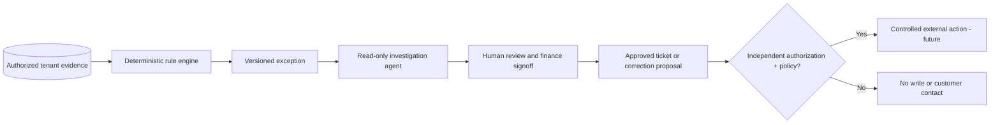

# Integrations and agent architecture

This file describes both the **working provider-neutral pilot** and the **future integration contracts**. Product claims must match the shipped connector list; target integrations and agent modules below are **design proposals**, not runnable code.

## Existing integration surfaces

### CSV imports — built

| Dataset route | Required columns (see sample for exact order and optionals) | Authority and keys |
| --- | --- | --- |
| `POST /api/import/contracts` | customer_id, customer_name, metric, currency, unit_price_cents, included_units, monthly_minimum_cents, effective_from; optional effective_to | Signed rate-card interpretation, unique customer/metric/start |
| `POST /api/import/mappings` | source, external_customer_id, customer_id | Exact source + external ID mapping; human verified |
| `POST /api/import/usage` | usage_id, customer_id, period, metric, quantity | Independent metering; unique usage_id |
| `POST /api/import/billing` | line_id, invoice_id, customer_id, period, metric, quantity, amount_cents, currency, status | Finalized invoice lines; stable line_id; paid/open counted |
| `POST /api/import/credits` | credit_id, customer_id, period, metric, amount_cents, reason | Explicit approved credit; stable credit_id |

CSV uploads have a 2 MiB HTTP size limit; the server parses and validates before updating a workspace. Periods use `YYYY-MM`; accepted currencies are USD/EUR/GBP. Historical source IDs are retained to support evidence. Reimporting a stable ID is an upsert, **not** proof that multiple provider feeds are deduplicated.

### Stripe invoice reader — built, limited

The Stripe connector uses `STRIPE_RESTRICTED_KEY` and `STRIPE_PRICE_MAP` stored on the server, and requires read-only invoice permissions. The browser never gets the secret. Price IDs must map explicitly to metrics; the adapter imports selected finalized full-month invoice lines with bounded pagination. No charge, refund, invoice mutation, customer email or customer payment action is performed. Unknown mappings, proration and broader adjustment semantics remain review items. The connector is optional; do not make it a platform dependency.

### Manual reconciliation schedule — built

`AUTO_SCAN_INTERVAL=24h` checks already imported data from a single process. Source fingerprint/date/rules changes cause new scans; no provider refresh occurs. This does **not** implement a durable ingestion pipeline.

## TARGET connector abstraction — not implemented

```text
ConnectorDefinition {
  connector_type, connector_version, supported_capabilities
  auth_modes, required_scopes, consent_evidence
  source_identity_namespace, data_contract_version
  backfill_limits, incremental_cursor_format
  rate_limits, webhook_signature_policy
  parse_and_validate(raw) -> CanonicalSourceRecord[]
  checkpoint_and_commit(batch, cursor) -> durable transaction
  emit_quality_event(source, period, reason)
}
```

Target canonical event provenance: `organization_id`, `connector_account_id`, `source_record_id`, `source_revision`, `provider_customer_id`, `canonical_customer_id`, `metric`, `period_start/end`, `observed_at`, `ingested_at`, `currency`, `quantity`, `status`, `payload_checksum`, `ingest_batch_id`, `source_watermark`, `confidence/verification_state`.

### Planned billing sources

| Adapter | Priority hypothesis | Required correctness checks |
| --- | --- | --- |
| Chargebee | Paid-design-partner driven | Credit notes, subscriptions, invoice state, proration, rate/term changes |
| Recurly | Paid-design-partner driven | Multi-subscription invoices, write-offs, status semantics |
| Zuora | Enterprise partner-driven | Usage rating, amendments, charge reversals, tax / entity boundaries |
| QuickBooks / ERP | Finance-demand driven | Posted journal/invoice state, payments, currency, adjustments |
| Stripe enhancements | Next within existing integration | Watermarks, retry/checkpoint, source-account mapping and invoice-level exceptions |

### Planned independent usage sources

| Adapter | Initial pattern | Risks |
| --- | --- | --- |
| Snowflake | Scoped read-only SQL from reviewed views | Query cost, timezones, late usage, row-level filtering |
| BigQuery | Tenant-scoped extraction from authorized billing dataset | Cost controls, event revision, dataset sharing |
| ClickHouse | Aggregated customer/metric/period read | Deduplication, event-time handling |
| S3/GCS/Blob | Signed object manifest and bounded ingestion | Incomplete uploads, revision semantics, schema drift |
| Application meter API | Signed cursor/event stream | Retry, out-of-order events, backfills, tamper/integrity evidence |

Do **not** implement all providers preemptively. Choose integrations only after design partners agree what independently authoritative sources they own, and write reconciliation fixtures for each source's actual semantics.

## Durable ingestion architecture (TARGET)

```mermaid
sequenceDiagram
  participant Scheduler
  participant DB as Tenant PostgreSQL
  participant Queue as Durable jobs / outbox
  participant Worker
  participant Source as Read-only provider API
  Scheduler->>DB: Create unique job key + tenant + requested window
  DB-->>Queue: Atomic outbox publication
  Queue->>Worker: Lease job with attempt and deadline
  Worker->>Source: Read paginated source since checkpoint
  Source-->>Worker: Validated records + next cursor
  Worker->>DB: Transactional upsert + provenance + watermark
  DB-->>Worker: Commit
  Worker->>Queue: Ack job
  Worker->>DB: Schedule reconciling only complete eligible periods
  Note over Worker,DB: On error: retry/backoff; DLQ and source quality warning after limit
```

Requirements: provider-scoped idempotency, per-org concurrency limits, signed webhooks with replay windows, auditable checkpoints, bounded pagination, partial-ingest detection, poison record isolation, dead-letter queue, alerting, health/lag SLIs, exponential backoff and connector deletion/credential rotation. No ingestion source is sufficient proof of cash recovery.

## TARGET AI / agent layer — not built

**Architecture principle:** deterministic source adapters and pricing rules calculate the money. LLM agents consume evidence, explain, suggest and draft. No agent receives credentials capable of unilateral invoice correction or collection.



### Agent roles

1. **Contract extraction assistant:** parse a PDF, quote/source-cite clauses, derive candidate price units, periods and amendments; each candidate must be reviewed and signed off before applying.
2. **Usage completeness assistant:** identify missing windows or suspicious meter discontinuities, explain watermarks and open an exception; never invent an unbilled amount.
3. **Investigation assistant:** gather allowed customer-specific evidence, offer likely explanations (late event, duplicate invoice, discount mismatch, override, incorrect mapping) with confidence and referenced record IDs.
4. **Pre-invoice assistant:** simulate unfinalized invoices using approved pricing rules and source completeness proofs; keep prevention estimates separate from current underbilling cases.
5. **Remediation assistant:** draft a finance review ticket, correction request or customer-safe note; no autonomous billing mutation or payment initiation.
6. **Portfolio analyst:** report consistent patterns by metric, provider, billing cohort or customer, never mixing currencies or stale source data.

### Agent safety requirements

- Every tool call derives an authenticated organization and user membership; no cross-tenant retrieval.
- All provider keys are encrypted with managed KMS, rotated, scoped and never presented to the LLM prompt.
- External text from contracts, webhooks and invoices is untrusted; isolate instructions, verify cited claims, and guard against prompt injection.
- Use JSON schemas for agent outputs, explicit allowlisted tools and bounded execution budgets.
- Capture trace/evidence for every suggestion and user action, redacted of secrets and unnecessary PII.
- Evaluate groundedness, false-positive escalation, unsafe action attempts, prompt injection, hallucinated contract terms and sensitive-data leakage.
- Perform **zero** financial calculation by freeform LLM arithmetic. All amounts come from versioned deterministic pricing rules with finance-approved fixtures.
- Require independent human approval before any external write. High-risk actions additionally need replay-safe idempotency, maker/checker and dry-run preview.
- Tenants opt in to use an AI provider, with documented processing, retention, region and privacy controls.

## Observability and limits

Current API does not expose reliable per-provider freshness SLIs, job queue, backfill status or agent traces. The production target should report connector lag, completeness coverage, rejected records, retry count, reconciliation age, currency-separated findings, precision measured from finance labels and true paid/verified ROI. Dashboards must visibly mark missing or stale evidence.

## Source validation release checklist

- [ ] Access is explicitly authorized, read-only and contractually permitted.
- [ ] API/provider scopes are limited, secrets encrypted and rotated.
- [ ] Source IDs, effective timestamps, timezone and currency verified.
- [ ] Pagination, rate limits and backfill boundaries tested.
- [ ] Signed webhooks with replay protection (if applicable).
- [ ] Idempotent ingest and corrected record revisions tested across restarts.
- [ ] Incomplete source data cannot silently produce confirmed cash.
- [ ] Two-org isolation tests for connector credentials and raw source exports.
- [ ] Disconnect/revoke and data deletion procedure completed.
- [ ] Finance owner signs expected output fixtures before live use.

See `docs/WORKFLOWS.md`, `docs/DATABASE-DESIGN.md` and `docs/IMPLEMENTATION-PLAN.md`.
