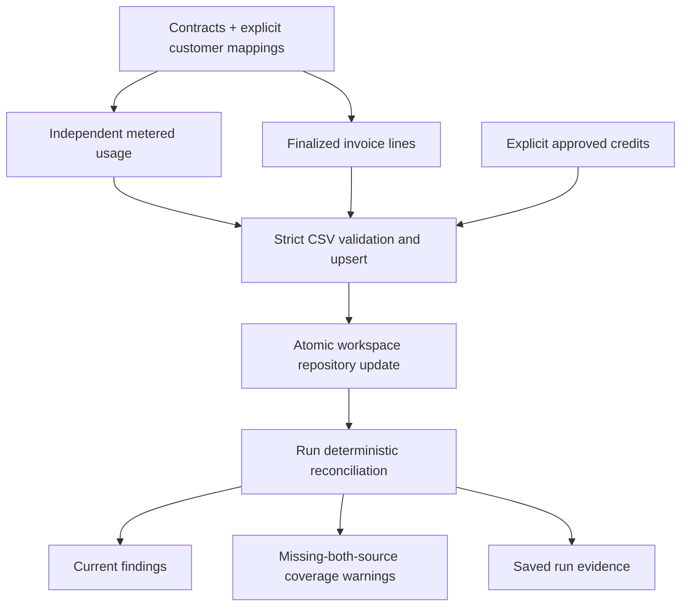
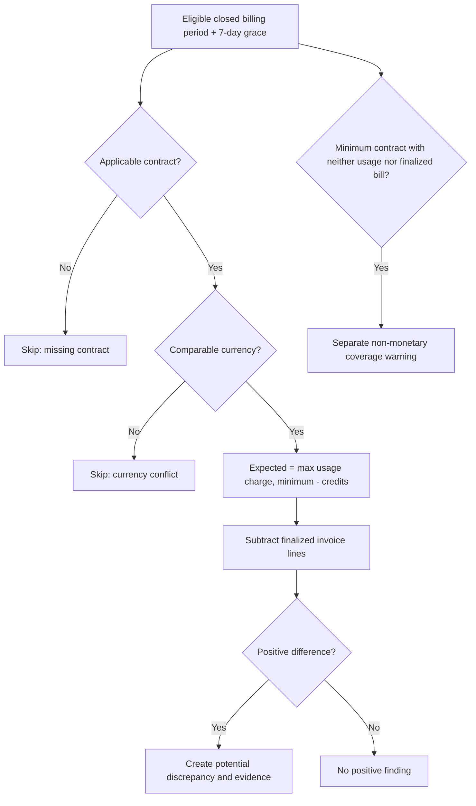
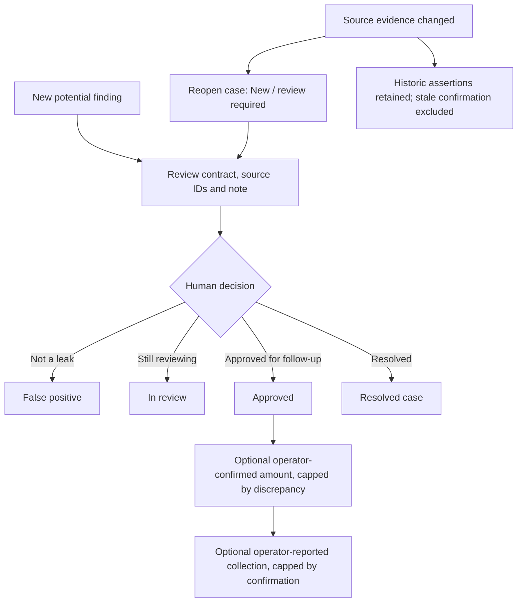

# End-to-end workflows and user journeys

**Built today** is a single-workspace, read-only pilot, not a fully automated multi-tenant revenue recovery platform. Every planned step below is explicitly labeled **TARGET**.

## 1. Workspace onboarding

### Built: local demo or private workspace

1. Start `DEMO_MODE=true go run ./cmd/server` bound to `127.0.0.1`; synthetic demo data is seeded.
2. To use a non-demo workspace, set a strong `ADMIN_PASSWORD`, independent `SESSION_SECRET`, `ADDR` and either `DATA_FILE` or `DATABASE_URL` plus static `WORKSPACE_ID`.
3. In PostgreSQL mode, a migration owner applies versioned SQL, provisions one organization, and grants a non-owner runtime role. The application fails startup for unprovisioned organizations or bypass-RLS roles.
4. Sign in through the single-admin session. The browser fetches `GET /api/me` and uses its CSRF token on write requests.
5. Upload synthetic/trusted finance CSV files and review findings.

**TARGET for commercial SaaS:** Self-service org creation, verified email/OIDC login, membership invitations, owner/admin/approver/analyst/viewer roles, MFA, SSO, trial/pilot terms and per-tenant consent. None are implemented. Do not invite unrelated real customers into one shared pilot instance.

## 2. Contracts and customer mapping

### Built

1. Operator obtains finance-approved rate cards with canonical `customer_id`, name, metric, currency, unit price in minor units, included units, minimum and effective month.
2. Upload contracts CSV. CSV ingestion parses/validates all rows before upserting.
3. If usage and billing providers use different customer identifiers, import `mappings.csv` with `source,external_customer_id,customer_id`. Source is one of `stripe`, `billing_csv`, `usage_csv` and `credits_csv`.
4. Review every mapping manually. Reimports replace the mapping for the same source/external ID; the previous raw source ID remains on independent data.
5. Imports recalculate eligible periods, reopening findings if evidence changed.

**TARGET:** Contract document OCR, citation-based term extraction, human verification, amendment approvals, entity resolution suggestions with confidence and collision review, account / currency lifecycle, many-to-one identity signoff and per-tenant mapping approval. Never auto-approve a mapping from name similarity.

## 3. Usage and billing ingestion



### Built

- Import usage via stable `usage_id` and period `YYYY-MM`; import billing line `line_id`, invoice ID, customer, metric, quantity, currency, amount, status and source; add explicit credit records.
- Importing a CSV saves source data and rescans in one datastore transaction; invalid parse results do not mutate state.
- Optional Stripe invoice sync pulls mapped, read-only invoice lines. The Stripe account is **not** the product's payment provider, and this action never creates a charge.
- No automated poller refreshes remote provider data. `AUTO_SCAN_INTERVAL` checks already-stored data and is **not** continuous ingestion.

**TARGET:** Ingestion connectors for Chargebee/Recurly/Zuora and independent usage sources (warehouse, database, S3, app API), each with test connection, backfill, incremental cursor/watermark, webhook signatures, idempotency, rate-limit backoff, DLQ, source freshness alerts and explicit data completeness certificates.

## 4. Reconciliation and quality warnings



The finding type (missing invoice, unbilled usage, minimum shortfall, price mismatch) is a **heuristic explanation**, not a legal proof of which system failed. Numerical overflow, missing contract, open periods and mismatched currency are skip reasons. A single source record closes only the narrow *both missing* coverage warning; it does not prove complete data.

**TARGET:** Advanced contract rules (tiered/graduated pricing, annual commitments, prepaid drawdown, discounts, credits, mid-cycle changes, taxes/refunds, shared minima), arbitrary period normalization, finance-approved golden fixtures, pre-invoice simulation and reconciliation when independent sources are stale or incomplete.

## 5. Investigation, review, finance assertion



### Built

1. Reviewer opens Investigations and examines contract rate, included units, invoiced amount, source event/line IDs, credits and explanation.
2. Change status (`new`, `reviewing`, `approved`, `false_positive`, `resolved`) and add a note. Saving writes an audit event.
3. For an approved/resolved finding, optionally create a **finance assertion** with current `evidence_digest`, action `confirmed` or `collected`, positive integer minor-unit amount and a supporting note. The same idempotency key produces one event; different payloads with a reused key are rejected.
4. A confirmed total for the same current evidence cannot exceed the calculated potential amount. An operator-reported collection cannot exceed the confirmed amount for that evidence.
5. If source evidence changes, stale confirmations are excluded from current-evidence totals, and prior assertion history remains.
6. **No payment is initiated, no bank feed is queried and no invoice is issued.** These are single-admin operator statements, not a second-person finance approval or independently verified recovery.

**TARGET:** Case owner and SLA, ticket integration, time-stamped maker/checker approvals using distinct identities, corrections journal, bank/payment-provider verified receipts, externally anchored append-only audit, disputed balance workflows, escalations and verified ROI.

## 6. Evidence runs, exports and audit

- Manual scan, CSV import, Stripe sync, demo seed, and optional periodic scan save run evidence including inputs and result, rule version and SHA-256 source digest.
- Last **25** runs and **500** activity entries retained. `GET /api/scans` retrieves metadata; `GET /api/scans/{id}` and `/export` include sensitive source data.
- Findings CSV export lists current cases; historical run downloads preserve earlier source snapshots. Recovery assertions are separate current records, not part of the prior run payload.
- The audit log has no independently authenticated user identity. Hashes are **not** digital signatures and store operators could mutate JSON/JSONB.

**TARGET:** Configurable policy-driven retention, file encryption, immutable audit storage, forensic export, cryptographic evidence signatures, redaction/PII minimization, delegated auditor access and review attribution.

## 7. Backup, migration and recovery

```mermaid
sequenceDiagram
  actor Admin
  participant Old as Paused JSON Pilot
  participant CLI as migrate-pilot / backup-workspace
  participant PG as Empty PostgreSQL Workspace
  Admin->>Old: Stop writers and take offline backup
  Admin->>CLI: migrate-pilot -source FILE (dry run)
  CLI-->>Admin: Counts and SHA-256; no writes
  Admin->>CLI: migrate-pilot -apply (explicit)
  CLI->>PG: Transactional import only if version=0 and state={}
  PG-->>CLI: Commit
  CLI->>PG: Independent read-back
  CLI-->>Admin: SHA match or STOP
  Admin->>CLI: backup-workspace -output NEWFILE
  CLI-->>Admin: Mode 0600 no-clobber JSON
```

Backups are **plaintext JSON**. The operator must encrypt and securely retain them. A fresh-organization restore test is in CI. There is no scheduled vault, cloud PITR/WAL, credential recovery, public status page or production RPO/RTO.

## 8. User acceptance and pilot signoff workflow

For each design partner, capture source ownership, written processing consent, contractual ground truth, independent usage definition, invoice finalization states, period/currency rules and explicit exclusions. Perform offline, read-only scans of three to six known billing months. Classify every candidate: accepted, timing, credit, duplicate, source incomplete, commercial exception, false positive. Have finance sign off expected outputs in repeatable test fixtures. **Only** report customer-reported recoveries with an audit trail and a clear disclaimer until independently verified. Record time saved and whether the buyer commits to a paid subscription.

## 9. Planned agentic workflows — not in current code

- *Contract intelligence agent:* OCR and cite clauses, highlight ambiguities, suggest structured terms; finance confirms before a version is effective.
- *Ingestion quality agent:* detect missing hours/days, stale cursors, duplicate provider records and inconsistent metering contracts; creates an exception, not money.
- *Investigation agent:* join existing evidence and draft a root-cause hypothesis with links to source record IDs; **never decides final amount or posts charges**.
- *Pre-invoice agent:* simulate draft pricing against independent meter data and preventable errors in a separate review queue.
- *Remediation assistant:* propose an approval-ready invoice correction or issue-tracker ticket; execution requires explicit authorized human confirmation, policy and replay safety.
- *Portfolio agent:* summarize recurring discrepancy classes and trends; currency-specific reporting and audited source watermarks are prerequisites.

These target workflows require a signed-off safety model, cost controls, tenant-isolated tool access, immutable evidence, LLM evaluations, injection resistance and deterministic financial math. See [implementation plan](IMPLEMENTATION-PLAN.md).
